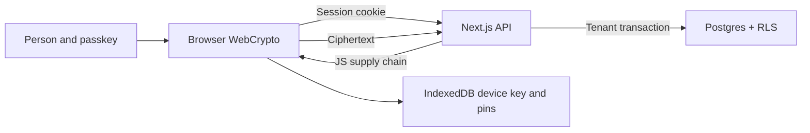

# Independent review package — OneAuth identity and Cloud developer preview

_Prepared 2 November 2026. No external specialist has reviewed or approved this system._

## Scope and release decision

Review PR #1 (identity foundation) and PR #2 (Cloud developer preview) at immutable commits supplied before engagement. Cloud is off on Production and restricted to disposable preview data. The reviewer should receive a fresh threat model, exact commit SHA, test/CI logs and a non-production environment. No real personal files are required.

## Architecture and trust boundaries

The API authenticates and authorises. The browser encrypts and holds key material. The server can deny access, send a modified bundle, change first-use public keys or tamper with ciphertext metadata. Human code comparisons are an explicit security boundary. See `docs/security/threat-model.md`.

## Constructions and on-disk formats

| Component | Construction | Code / specification |
| --- | --- | --- |
| File content | Random 256-bit FK; 1 MiB chunks, random 96-bit AES-GCM nonce; AAD = `oneauth/v1/chunk` + 16-byte file UUID + complete 16-byte OAC1 header + uint32 index | `lib/vault/crypto.ts`, `docs/cloud/security-design.md` §4 |
| Metadata, folder and Space item | AES-GCM; random nonce; purpose label + UUID AAD; name/Space keys HKDF-SHA256(VK, vault UUID salt, separate info strings) | `lib/vault/crypto.ts` |
| File-key envelope | AES-KW(VK, FK); random per-file-version FK | `lib/vault/crypto.ts` |
| Device envelope | JWE compact `ECDH-ES+A256KW` / `A256GCM`, P-256, version in authenticated protected header | `lib/vault/crypto.ts`, `lib/vault/keystore.ts` |
| Recovery | 256 random bits + checksum, HKDF-derived AES-KW key and separate proof, server stores SHA-256 of proof | `lib/vault/crypto.ts`, `lib/server/cloud/vault.ts` |
| Rotation | New VK; HMAC transition proof derived from outgoing VK; staged `next_*` columns, atomic commit; optional re-entry of recovery key | `lib/vault/trust.ts`, `rotate.ts`, `lib/server/cloud/rotation.ts`, migration 0007 |
| Deep rotation | Decrypt/re-encrypt to new file ID/FK; server verifies ciphertext SHA-256, atomically swaps, releases old quota | `lib/vault/client.ts`, `lib/server/cloud/items.ts` |
| Browser trust | Highest version and commitment pins plus non-extractable transition keys in IndexedDB; first-use confirmation code | `lib/vault/trust.ts`, `keystore.ts` |

## Reviewer priority questions

1. **Critical:** A removed browser holding outgoing VK colludes with a DB-writing server. It forges the HMAC transition to an attacker VK and plants a pending rotation. An active browser's `rotationNextKey` accepts and `finishRotation` rewraps file keys. What independent authorisation anchor and lost-device fallback make this safe? Check the Phase 2D collusion test.
2. Can a server substitute a first-use or newly approved envelope when a person omits, misreads or is socially engineered during the fingerprint and confirmation code comparisons? Are 60 bits and the UX adequate?
3. Can recovery proofs, stored verifiers, key version, vault ID or a restored backup be used for rollback, substitution or cross-vault confusion? What survives IndexedDB eviction?
4. Are all OAC1 header bytes, chunk order, count, file ID and metadata object IDs authenticated? Are random-nonce collision bounds and memory/size limits acceptable at intended scale?
5. Does keeping a recovery key after a rotation allow a removed browser to retain access? The server tracks recovery-flow use, but cannot know if the key was copied by another means.
6. Does deep rotation preserve data and quota under corruption, cancellation, concurrent delete/move, retries and interrupted migration? What remains in Neon backups?
7. Can SQL injection or a runtime credential alter `oneauth.user_id` despite RLS? Review parameter binding, SECURITY DEFINER functions, grants, `search_path`, session reset and PgBouncer behaviour.
8. Can an attacker bypass CSRF/origin checks, replay passkey challenges, relay pairing or recover a revoked session? Examine cookie scope, step-up lifetime and rate-limit failure paths.
9. What does a compromised deployment, extension or same-origin script do to unlocked keys? Define realistic code-transparency or native-key strategies; avoid promising protection from a fully compromised client.
10. Evaluate S3/R2 design before implementation: scoped, short-lived presigned part URLs; part ordering/hash; reservation reconciliation; orphan cleanup; backups and deletion language.

## Reproduction and evidence map

- `tests/unit/vault-crypto.test.ts`: tampered header/chunks, wrong identifiers, recovery and wrapping.
- `tests/integration/key-trust.test.ts`: planted proof rejected without old key; Phase 2D fixture shows removed old-key holder can forge it.
- `tests/integration/{cloud-adversarial,cloud,key-rotation,deep-rotation,tenant-isolation,auth,webauthn-negative,pairing}.test.ts`: BOLA, RLS, quota, concurrency, partial rotation and authentication paths.
- `tests/e2e/cloud.spec.ts`, `tests/hosted/cloud-adversarial.spec.ts`: virtual authenticator, two-browser encrypted transfer and public API adversarial paths. Hosted suite result of 9/9 was previously reported; this package independently verified CI 213/46 at `abd324d`, not a fresh hosted 9/9 run.
- GitHub CI: run `41424192020`, 17 Vitest files/213 tests, 46 Playwright tests, typecheck/lint/build green at `abd324d4c80cd43424e60b8ed10154d585e82908`.
- Phase 2D branch adds `tests/unit/error-redaction.test.ts` and the collusion fixture; CI on its own commit is required.

## Review deliverables to request

Ask the independent specialist for a written threat-model review, protocol and implementation findings with reproductions and severity, a cryptographic construction assessment, a device/browser trust assessment, and a retest of fixes at a pinned commit. Separate architecture changes from code defects. No real-data release until high/critical findings close, physical-device evidence is collected, and the specialist explicitly signs off on the final protocol and implementation.

Do not send access, credentials, private data or payment to a reviewer before owner approval and a defined scope.
