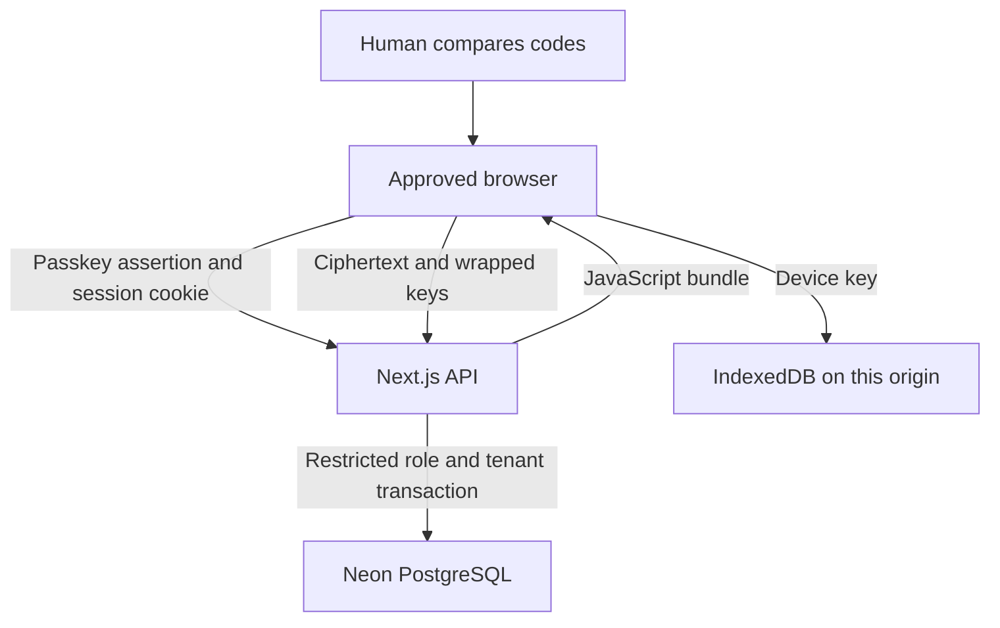

# OneAuth threat model — Phase 2D review

_2 November 2026. Developer preview only. This is an internal assessment, not independent approval._

## System and trust boundaries

The browser generates vault, recovery and file keys. It encrypts before upload. PostgreSQL stores ciphertext and metadata, but can change, replay, omit or delete rows if compromised. The API authenticates sessions, authorises resources, enforces quotas and supplies JavaScript. A compromised build or origin can run malicious JavaScript and read an unlocked vault; browser-delivered encryption cannot defend against that adversary. A non-extractable IndexedDB key prevents raw export through WebCrypto, but same-origin script can use it.

## Assets and adversaries

| Asset | Adversary capability | Boundary / residual risk |
| --- | --- | --- |
| File plaintext and names | DB or storage read/write | OAC1 AEAD and sealed metadata; sizes, counts, timing and tree shape remain visible. Deletion is subject to backups. |
| Vault and file keys | DB write, malicious API, removed browser | Recovery AES-KW and device JWE; a removed browser may retain its old vault key, file keys and plaintext. |
| Device approval | Malicious server substitutes a public key | Both screens must compare the locally computed 60-bit fingerprint, followed by the received-key confirmation code. Skipping either comparison defeats this check. |
| Key transition | Removed browser retains outgoing key and colludes with DB-writing server | It can make a valid HMAC transition proof for the step it knew. The proof identifies possession of the old key, not an authorised still-active browser. An interrupted rotation can be planted for an active browser to finish; no trusted external anchor prevents this. **Release blocker** pending protocol redesign and independent review. |
| Browser trust pins | Server rollback or key substitution | Known-version commitments and max version are persisted in IndexedDB. Site-data clearing, a new browser, or malicious same-origin JavaScript removes this anchor. |
| Session and account data | Other account / stolen session | HTTP-only cookie, server scope checks and RLS. RLS with a client-set transaction GUC is defence against application query omissions; arbitrary SQL execution as the app role could set another tenant ID. |
| Availability | Malicious server / quota abuse | The server can always withhold or delete ciphertext. Quota and upload count gates limit honest API clients; rate limits are not a substitute for provider abuse controls. |

## Critical scenario and evidence

The Phase 2C proof check rejects a DB writer who **does not know** the outgoing key. `tests/integration/key-trust.test.ts` reproduces that rejection. The Phase 2D collusion fixture revokes browser B, lets it retain VK1, plants an attacker-chosen VK2 and a proof it can compute, and demonstrates `verifyResume` accepts the proof. This is a controlled test of the trust boundary, not evidence that a production compromise occurred. A server that also controls delivered JavaScript can exfiltrate keys directly.

Do not label this scenario resolved. A safe replacement must establish authorisation using an anchor unavailable to a removed old-key holder (for example, independently confirmed active-device signatures with durable public-key pinning and recovery semantics). Design the fallback for single-device interruption, device loss and site-data clearing before changing the preview protocol. An external specialist must review the construction and migration.

## Assumptions and out-of-scope facts

- Passkeys authenticate the server session; they are not file-encryption keys. Physical biometric and OS authenticator behaviour is untested.
- A compromised extension, same-origin XSS, or compromised client device can access data while unlocked. CSP reduces injection surface but does not protect against malicious served code.
- A malicious DB can cause denial of service, replace a first-use envelope, or erase recovery material. Recovery authenticity derives from possession of the recovery key and AES-KW, with no independent commitment after key loss.
- Deep rotation protects old ciphertext only after every object is re-encrypted and old backups expire; already downloaded copies cannot be revoked.
- S3/R2 is a design, not a running storage driver. Presigned URL scope, multipart integrity, orphan cleanup, quota reconciliation, backup retention and delete semantics require implementation and review.
